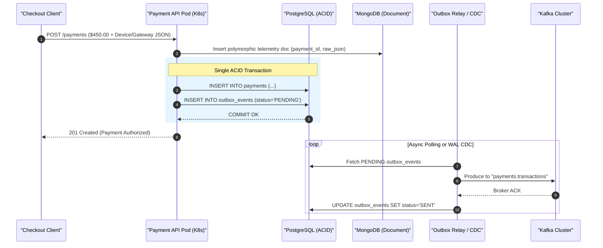
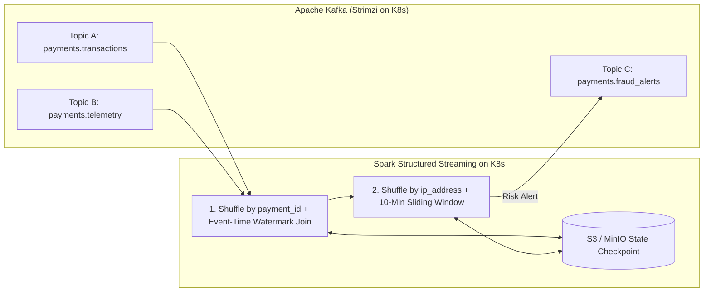

# SentinelPay: Architecture & Engineering Revision Handbook

> [!IMPORTANT]
> **How to use this handbook:** After every interactive design round and hands-on lab, this document is updated with concise revision notes, architectural diagrams, trade-off tables, and production interview takeaways.

---

## Table of Contents
1. [Module 0: Problem Statement & Tech Stack Justification](#module-0-problem-statement--tech-stack-justification)
2. [Module 1: Ingestion, OLTP Split & Event Reliability (Round 1)](#module-1-ingestion-oltp-split--event-reliability-round-1)
3. [Module 2: Stateful Stream Processing (Spark) & Cloud Warehousing (Round 2 - In Progress)](#module-2-stateful-stream-processing-spark--cloud-warehousing-round-2---in-progress)
4. [Module 3: Containers & Kubernetes Architecture (Upcoming)](#module-3-containers--kubernetes-architecture-upcoming)
5. [Module 4: Infrastructure as Code with Terraform - Deploy & Undeploy (Upcoming)](#module-4-infrastructure-as-code-with-terraform---deploy--undeploy-upcoming)
6. [Module 5: CI/CD & GitOps Pipelines (Upcoming)](#module-5-cicd--gitops-pipelines-upcoming)

---

## Module 0: Problem Statement & Tech Stack Justification

### The Business Problem ("SentinelPay")
A digital payment processor handles high-throughput checkout transactions across multiple payment methods (Cards, Apple Pay, UPI, Wallets) while collecting device telemetry. The platform must:
1. Maintain a **100% consistent financial ledger** (zero double-charges or lost records).
2. Ingest **schema-flexible gateway & device payloads** that vary across payment providers.
3. Detect **velocity fraud in real time** (e.g., sliding 10-minute windows across merchants/IPs).
4. Power **historical analytics & financial reconciliation** over multi-year data via SQL.
5. Support **automated Cloud Deploy & Undeploy** on **AWS (EKS)** / **Azure (AKS)** via **Terraform** to eliminate idle cloud costs.

### Why Each Technology Exists (Zero "Resume-Driven" Fluff)

| Layer | Technology | AWS Service | Azure Equivalent | Production Justification |
| :--- | :--- | :--- | :--- | :--- |
| **Relational OLTP** | **PostgreSQL** | Amazon RDS / Aurora | Azure DB for PostgreSQL | Strict ACID transactions, row locking, and schema enforcement for financial ledger (`payments`, `merchants`, `outbox_events`). |
| **Document Store** | **MongoDB** | Amazon DocumentDB | Azure Cosmos DB (Mongo API) | Stores polymorphic, deeply nested JSON payloads (device fingerprints, Stripe/ApplePay/UPI webhook responses) without 200+ nullable SQL columns. |
| **Event Backbone** | **Apache Kafka** (Strimzi on K8s) | Amazon MSK | Azure Event Hubs (Kafka API) | Decouples operational APIs from downstream consumers; provides durable, replayable, partitioned event logs. |
| **Stream & Batch Compute** | **Apache Spark** (Spark Operator on K8s) | Amazon EMR on EKS | Azure HDInsight on AKS / Databricks | Stateful stream-to-stream joins, watermarking, sliding time windows, and Medallion (Bronze $\rightarrow$ Silver) compaction. |
| **Lakehouse Storage** | **Delta Lake on S3 / MinIO** | Amazon S3 | Azure Data Lake Storage (ADLS Gen2) | Open-format ACID tables over cheap object storage (`Parquet` + transaction log). |
| **Cloud Data Warehouse** | **Snowflake + dbt SQL** | Snowflake on AWS | Snowflake on Azure | High-concurrency OLAP SQL warehouse for Gold-layer BI dashboards, historical cohort analysis, and ELT transformations. |
| **Container Orchestration** | **Kubernetes** | Amazon EKS | Azure AKS | Runs microservices, Strimzi Kafka Operator, and Spark Operator with self-healing, autoscaling, and declarative state. |
| **Infrastructure as Code** | **Terraform** | AWS Provider | AzureRM Provider | Declarative provisioning (`terraform apply`) and clean teardown (`terraform destroy`) of VPC/VNet, K8s clusters, IAM, and storage. |

---

## Module 1: Ingestion, OLTP Split & Event Reliability (Round 1)

### 1.1 PostgreSQL vs. MongoDB: When to Use Which?

* **Initial Intuition:** Store `customer_id` in MongoDB as a cache layer for fast customer lookups, and store all other attributes in PostgreSQL.
* **Production Refinement:**
  * **Cache vs. Document DB:** If you only need a fast in-memory key-value cache, use **Redis**. **MongoDB** is a persistent document database chosen here for **Schema Polymorphism**.
  * **Correlation Keys:** Both databases store `payment_id` and `customer_id` so records can be linked across systems.
  * **PostgreSQL (`payments` table):** Stores structured, invariant financial attributes (`payment_id`, `customer_id`, `merchant_id`, `amount`, `currency`, `status`, `created_at`). Requires ACID guarantees and strict types (`NUMERIC(12,2)`).
  * **MongoDB (`payment_telemetry` collection):** Stores semi-structured/polymorphic context (`payment_id`, `customer_id`, `device_fingerprint: {...}`, `gateway_raw_response: {...}`). Prevents sparse SQL tables and frequent `ALTER TABLE` schema migrations when 3rd-party gateways change fields.

### 1.2 Solving the Dual-Write Problem: The Transactional Outbox Pattern

* **The Problem:** If a microservice commits a payment to PostgreSQL and then calls `kafkaProducer.send()`, a pod crash or network timeout between those two lines causes **data inconsistency** (the database has the payment, but Kafka never receives the event).
* **The Solution (Transactional Outbox Pattern):**
  1. Inside a **single PostgreSQL ACID transaction (`BEGIN ... COMMIT`)**, insert the row into `payments` AND insert an event payload into `outbox_events` with `status = 'PENDING'`.
  2. Either both writes succeed together, or both roll back together.
  3. An asynchronous **Outbox Relay / Change Data Capture (CDC)** process reads `PENDING` events (or tails the PostgreSQL Write-Ahead Log via Debezium), publishes them to Kafka, waits for the broker `ack`, and marks the event `SENT`.

> [!TIP]
> **Interview & Production Takeaway (Idempotency):**
> Because the Outbox Relay guarantees **At-Least-Once delivery** (what if the Relay publishes to Kafka, receives the ACK, and crashes *before* updating PostgreSQL to `SENT`?), the Relay might publish the same `payment_id` twice upon restart. Therefore:
> 1. Enable Kafka **Idempotent Producer** (`enable.idempotence=true`).
> 2. Downstream consumers (like Spark) must deduplicate by `payment_id`!

---

## Module 2: Stateful Stream Processing (Spark) & Cloud Warehousing (Round 2)

### 2.1 Why Apache Spark Instead of a Standard Kafka Consumer Microservice?

* **The Scenario:** Join **Topic A (`payments.transactions`)** and **Topic B (`payments.telemetry`)** on `payment_id`, then aggregate by `ip_address` over a **sliding 10-minute window** (`SUM(amount) > $2,000` across `COUNT(DISTINCT merchant_id) >= 3`).
* **Your Initial Intuition (Spot-On!):**
  1. **Cross-Node Partition Mismatch:** Records from Topic A and Topic B (or records for the same `ip_address` after joining) can land on different Kubernetes pods/nodes, so no single pod has the unified view.
  2. **Out-of-Order / Asynchronous Arrival:** Topic A and Topic B messages arrive at different times (or out of order due to network lag), breaking naive in-memory joins and 10-minute time windows.

* **How Spark Structured Streaming Solves This in Production (3 Core Concepts):**

| Challenge in Plain Kafka Consumers | How Apache Spark Solves It Automatically |
| :--- | :--- |
| **1. Multi-Key Partitioning (Join on `payment_id`, then Group By `ip_address`)** | **Distributed Shuffle (`Exchange`):** Spark automatically redistributes data across Executor pods over the network—first co-locating Topic A & B records by `payment_id` for the join, then re-shuffling by `ip_address` for the 10-minute window aggregation. |
| **2. Out-of-Order & Delayed Events** | **Event-Time & Watermarking (`withWatermark`):** Spark evaluates windows using **Event Time** (the timestamp inside the payload when the payment occurred) rather than **Processing Time** (when the pod read it). Setting a watermark (e.g., `2 minutes`) tells Spark how long to buffer and wait for late-arriving data before closing a window. |
| **3. Pod Crash at Minute 9 of a 10-Minute Window** | **Distributed State Store + S3 Checkpointing:** Spark maintains window state in a fault-tolerant State Store and writes incremental checkpoints to **S3 / MinIO** every micro-batch. If a Kubernetes pod crashes, a replacement pod restores the exact window state from S3 without losing the 9-minute running totals. |

### 2.2 PostgreSQL (OLTP) vs. Snowflake / Delta Lake (OLAP) *(Up Next)*

*(Notes will be added here after we discuss Question 2!)*
